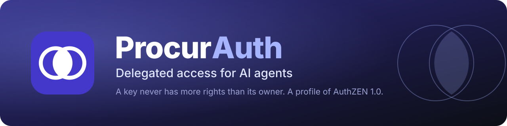
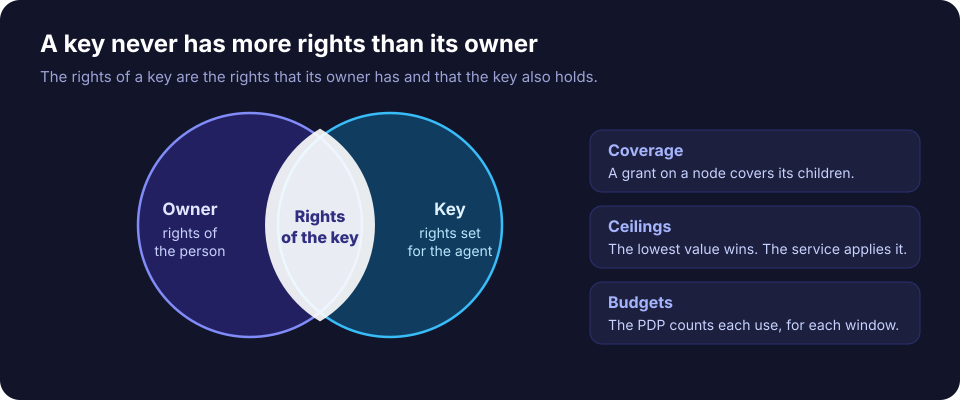
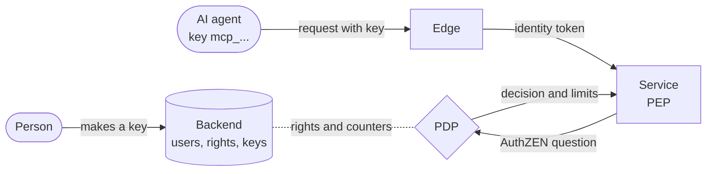
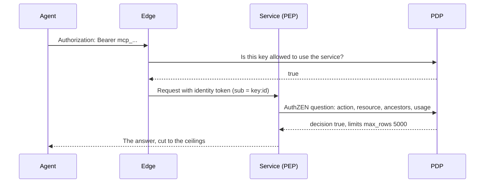
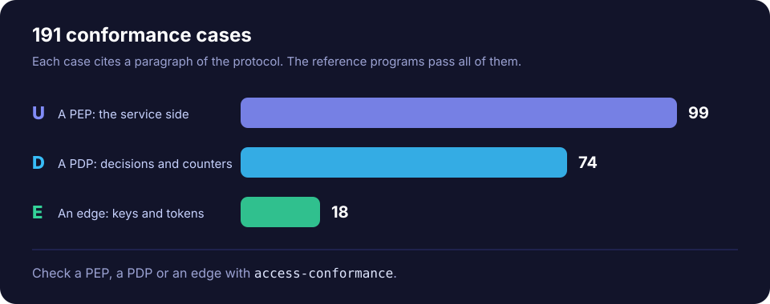

<p align="center">
  
</p>

<p align="center">
  <a href="https://github.com/SCcagg5/procurauth/actions/workflows/ci.yml"></a>
  <a href="https://github.com/SCcagg5/procurauth/releases/latest"></a>
  
  
  
  
</p>

<p align="center">
  <a href="https://sccagg5.github.io/procurauth/"><b>Website</b></a> ·
  <a href="https://sccagg5.github.io/procurauth/specification.html">Protocol</a> ·
  <a href="https://sccagg5.github.io/procurauth/mcp-binding.html">MCP binding</a> ·
  <a href="https://sccagg5.github.io/procurauth/tools.html">Tools</a> ·
  <a href="https://sccagg5.github.io/procurauth/conformance.html">Conformance</a> ·
  <a href="https://github.com/SCcagg5/procurauth/releases/latest">Downloads</a>
</p>

# ProcurAuth

ProcurAuth is an open specification for services that let AI agents act for people.

A backend holds the users, their rights and the keys of their agents. A person makes a key for an agent. **A key never has more rights than the person who owns it.** A service does not know the backend. It speaks only [AuthZEN](https://openid.net/specs/authorization-api-1_0.html).

This repository holds the protocol, the MCP binding, the JSON schemas, 191 conformance cases and the programs to test a service.

<p align="center">
  
</p>

## How it works

An agent calls a service with its key. The edge swaps the key for a short identity token. The service asks the decision point (PDP) with one AuthZEN question. The PDP answers with the decision and the limits that apply.





The protocol has these main parts:

| Part | What it gives |
| --- | --- |
| **Keys** | A key has the subject `key:<id>`. A key has its own grants, and never more than its owner. |
| **Resource chains** | A service sends `resource.properties.ancestors`. A grant on a node covers all its children. |
| **Limits** | A ceiling is a value that the service applies, such as `max_rows`. A budget is a count that the PDP keeps, such as requests for each minute. |
| **Identity token** | A short JWT (`Ed25519` or `ES256`) that the edge signs. The service reads `sub` and sends it to the PDP. |
| **Refusals** | A PDP answers `false`, with the reason `budget_exceeded` and `retry_after` when a budget is spent. |
| **MCP binding** | The rules for a service with an MCP endpoint: tools, approvals and JSON-RPC errors. |

## Example

Alice has the grant `data.read` on the database `test2`, with `max_rows` 5000. She also has a grant on the table `orders`, with `max_rows` 100. The service asks one question:

```json
{ "subject":  { "type": "user", "id": "alice" },
  "action":   { "name": "data.read" },
  "resource": { "type": "table", "id": "orders",
                "properties": { "ancestors": [ { "type": "service", "id": "datastore" },
                                               { "type": "host", "id": "prod" },
                                               { "type": "database", "id": "test2" } ] } },
  "context":  { "usage": { "units": 1 } } }
```

The PDP answers with the lowest value of each ceiling:

```json
{ "decision": true, "context": { "limits": { "max_rows": 100, "max_duration": 30 }, "usage": { "units": 1 } } }
```

When the budget is spent, the answer is:

```json
{ "decision": false, "context": { "reason": "budget_exceeded", "retry_after": 12 } }
```

Section 13 of the protocol has the full example, with the key of an agent.

## Tools

Seven programs help you to build and to test a service. They are Rust programs. Each one is a static file with no dependency.

| Program | What it does |
| --- | --- |
| `keycheck` | Checks the text of a key against a key format. |
| `access-token` | Makes and checks identity tokens. It runs the checks of protocol 9.4 and prints the result of each one. |
| `access-lint` | Checks the action document of a service, a file of grants and an answer of the options route. |
| `fake-pdp` | A test PDP that serves AuthZEN 1.0 from fixed data. Use it to run a service with no backend. |
| `access-conformance` | Runs the conformance cases against a PEP, a PDP or an edge. |
| `reference-service` | A small service that uses the library `procurauth-pep`. It passes the series U. |
| `reference-edge` | A small edge: a reverse proxy that swaps a key for a token. It passes the series E. |

The library `procurauth-pep` in `crates/procurauth-pep` has the checks that a PEP must do.

### Get the programs

Each [release](https://github.com/SCcagg5/procurauth/releases/latest) has archives for Linux (x86-64 and aarch64), macOS (Apple silicon and Intel) and Windows (x86-64). The Linux programs are static.

```sh
curl -LO https://github.com/SCcagg5/procurauth/releases/download/v1.0/procurauth-tools-1.0-x86_64-linux.tar.gz
curl -LO https://github.com/SCcagg5/procurauth/releases/download/v1.0/SHA256SUMS
sha256sum -c SHA256SUMS --ignore-missing
tar xzf procurauth-tools-1.0-x86_64-linux.tar.gz
./procurauth-tools-1.0-x86_64-linux/access-token --help
```

### Check an identity token

The tool prints one line for each check. This is a short extract.

```text
$ access-token check --config service.json token.jwt
structure  ok   3 parts
header     ok   no `crit`
alg        ok   Ed25519
typ        ok   JWT
signature  ok   good
claims     ok   iss, sub, aud, iat, exp
aud        ok   datastore
life       ok   life 300 s, max 300 s
```

## Conformance

<p align="center">
  
</p>

The cases are data, in `conformance/`. Each case cites a paragraph of the protocol. `conformance/COVERAGE.md` shows which paragraph has a case. To test your own service, write a profile and run the cases:

```sh
access-conformance --role pep  --profile my-service.json --url http://127.0.0.1:8000
access-conformance --role pdp  --profile my-pdp.json     --url http://127.0.0.1:8001
access-conformance --role edge --profile my-edge.json    --url http://127.0.0.1:8002
```

The runner prints one line for each case and a summary line, for example `99 cases: 99 passed, 0 failed, 0 skipped`.

## JSON schemas

The directory `schemas/` has a JSON Schema for each document and each file of the tools. The site serves a copy of each schema at the address in its `$id`.

| Schema | Describes |
| --- | --- |
| [`action-document`](schemas/action-document.schema.json) | The document of a service at `/.well-known/procurauth/actions`. |
| [`options-route-answer`](schemas/options-route-answer.schema.json) | The answer of the options route `/.well-known/procurauth/resources`. |
| [`evaluation-context`](schemas/evaluation-context.schema.json) | The members that the protocol adds to `context` of an AuthZEN question. |
| [`identity-token-claims`](schemas/identity-token-claims.schema.json) | The claims of the identity token. |
| [`limit-values`](schemas/limit-values.schema.json) | The limit values that one grant gives. |
| [`key-format`](schemas/key-format.schema.json) | The format of the text of a key. |
| [`conformance-case`](schemas/conformance-case.schema.json) | One conformance case. |
| [`conformance-profile`](schemas/conformance-profile.schema.json) | How the runner reaches a target. |
| [`conformance-report`](schemas/conformance-report.schema.json) | The result of a run. |
| [`fake-pdp-data`](schemas/fake-pdp-data.schema.json) | The data of the test PDP. |
| [`grants-file`](schemas/grants-file.schema.json), [`options-file`](schemas/options-file.schema.json) | The inputs of `access-lint`. |
| [`access-token-config`](schemas/access-token-config.schema.json) | The configuration of `access-token`. |
| [`keycheck-output`](schemas/keycheck-output.schema.json), [`access-lint-output`](schemas/access-lint-output.schema.json) | The JSON output of two tools. |

## Repository

| Path | Content |
| --- | --- |
| `protocol/` | The protocol, in Markdown. It is neutral and does not name a product. |
| `bindings/mcp/` | The binding for services with an MCP endpoint. |
| `schemas/` | The JSON schemas. |
| `conformance/` | The cases, the model and the coverage table. |
| `crates/` | The Rust programs and the library. |
| `docs/` | The source of the [website](https://sccagg5.github.io/procurauth/). GitHub Pages serves this directory. |
| `devdocs/` | The notes for a developer of this repository. |
| `IMPLEMENTATIONS.md` | The known implementations. Add yours with an issue. |

### Build and test

Use Docker. Do not install Rust on your machine.

```sh
scripts/ci.sh                 # format, lint, tests and the conformance runs
scripts/cargo.sh build --release
scripts/static.sh --check     # static Linux programs (musl)
```

## Licences

- The texts are under CC BY 4.0. See `LICENSE-TEXTS.txt`.
- The code is under Apache-2.0. See `LICENSE`.

## Contribute

Open an issue to ask a question or to report an error in the texts. Cite the number of the paragraph. To add an implementation, give its name, its role (PEP, PDP or edge), a link and the result of `access-conformance`.
